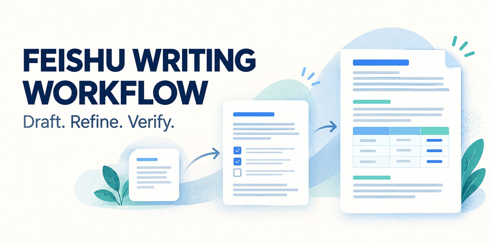
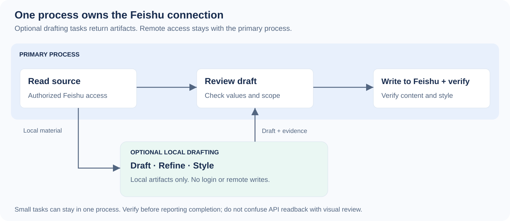
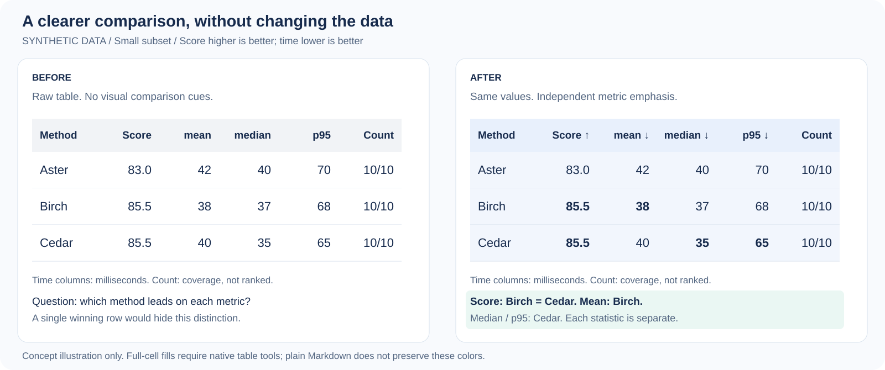

<p align="center">
  
</p>

# Feishu Writing Workflow · 飞书写作工作流

**在飞书里，把资料写清楚，把表格讲明白，把修改核对完整。**

面向 Codex 的飞书文档写作与编辑技能。支持从资料创建文档、改写与翻译、精简汇报、结构调整、局部更新，以及文档内表格的撰写与美化。先制作并审核草稿，再由主进程写入飞书、回读验证。

> 私有审阅版：[LadyK666/feishu-writing-workflow](https://github.com/LadyK666/feishu-writing-workflow)。尚未公开发布或被目录收录。全部示例使用虚构资料，图片是概念示意。本项目不是飞书官方产品，也未获官方背书。

[安装与连接](#安装与连接) · [使用场景](#这样使用) · [主技能](skills/feishu-document-workflow/SKILL.md) · [表格技能](skills/table-writing-and-styling/SKILL.md) · [发布指南](docs/PUBLISHING.md)

## 一套飞书写作流程



主进程统一使用飞书连接。复杂任务可以将资料整理、章节改写、文稿压缩、表格设计交给子模型，子模型只返回本地成品与来源对应，不登录飞书、不扫描二维码、不直接修改线上文档。小任务直接完成，不强制启动一组角色。

## 安装与连接

这个仓库包含两个相互配合的技能：

| 技能 | 负责什么 |
|---|---|
| `feishu-document-workflow` | 飞书写作入口、编辑边界、资料组织、子任务交接、审核与写回 |
| `table-writing-and-styling` | 文档表格的结构、逐指标最优值、文字重点、蓝绿配色与整格底纹 |

使用 [Skills CLI](https://github.com/vercel-labs/skills) 安装，并在选择界面中选择这两个技能。当前仓库为私有，安装者需要相应访问权限与 GitHub 认证；公开后才能供所有人直接获取：

```sh
npx skills add LadyK666/feishu-writing-workflow -a codex
```

默认安装到当前项目；用户级安装添加 `-g`。Skills CLI 当前要求 Node.js 22.20 或更新版本，安装参数见 [命令文档](https://github.com/vercel-labs/skills/blob/main/docs/commands.md)。Codex 技能加载与安装约定见 [官方文档](https://learn.chatgpt.com/docs/build-skills)。

### 飞书连接是使用前提

写作规则不替代平台连接。本项目不打包账号、应用密钥、登录态或个人 CLI 路径。可以沿用已有可用的飞书连接；推荐结合 [飞书官方 CLI 与技能](https://github.com/larksuite/cli)，由它们处理当前命令语法与授权。

尚未安装官方工具时，参考其当前安装指南：

```sh
npx @larksuite/cli@latest install
npx skills add larksuite/cli --skill lark-doc -a codex
npx skills add larksuite/cli --skill lark-shared -a codex
```

需要文档搜索、真正复制文档、文件权限或独立评论操作时，按任务另装官方 `lark-drive`。本仓库不转发或复制官方技能源码。主进程按官方指引完成一次配置和用户授权，之后复用可用连接；不要每次写作都重新初始化账号或重复授权。

具体要求、身份选择、CLI 路径问题及失败处理见 [飞书连接说明](skills/feishu-document-workflow/references/connection.md)。无可用连接时可以制作本地草稿，但不能声称已经写进飞书。

## 这样使用

| 场景 | 请求示例 |
|---|---|
| 实验与日志写汇报 | “用这些实验记录在飞书新建汇报，先写已有结论，再列对比表；不新增计算或推断。” |
| 详细资料变简报 | “把这份飞书文档精简成组会汇报，允许重组，保留结论的条件、失败情况和关键数据。” |
| 全文润色与重构 | “润色这篇说明文档，调整章节和表达，事实、引用和限制不变。” |
| 局部编辑与翻译 | “只翻译指定章节，其余部分、链接和表格保持原样。” |
| 仅格式美化 | “美化这份飞书笔记，不改内容、数据和顺序；指定章节不要动。” |
| 指标表格 | “同一子集逐指标比较，mean、median、p95 分别加粗最优值；保留原精度。” |
| 文字表与行动表 | “用浅蓝、浅青绿整格底纹和少量粗体突出原有结论、行动与限制。” |
| 会议纪要与方案 | “根据提供的记录整理纪要和行动项，未知负责人保留未知，不把建议写成已决定事项。” |
| 审阅或制作草稿 | “只给修改稿和问题清单，不写回飞书。” |

任务可组合，修改权限分别判断。“美化”不意味着可以删内容，“整理”不意味着可以重算，“精简”不意味着可以省掉重要限制。

## 文档怎样写得清楚

按读者要完成的任务组织内容，不为每份文档套相同模板。汇报可以先放来源已有的结论与待讨论问题，再给关键证据；操作指南按步骤组织；纪要区分事实、决定、建议和待办。

标题形成清楚层级；粗体突出原有重点；引用保留来源；提示块用于真正需要提醒的条件和限制。配色默认蓝绿，避免每个段落都变成彩色块。保护区、原始链接、图片和附件随编辑范围一起核对。

对于已有文档，选择最小必要修改。评论、锚点、资源和修订信息不能只凭正文文字相同就认定完好。需要真正复制文档时，使用平台复制能力；不能把正文重新创建称为完整复制。

## 表格是写作中的一个组成部分



同一子集、同一条件、同一指标内比较；↑ 越高越好，↓ 越低越好。精确并列同等加粗，mean、median、p95 分别判断；覆盖与样本量不自动参加性能排名。自然语言表可以用粗体突出关键判断、行动和限制。

默认浅蓝表头、浅青绿辅助信息、深色正文。底纹铺满完整单元格或整行，不用文字背景块冒充整格底纹。没有分组时不人为制造分组，也不把一整行着色解释为各项都最好。

表旁总结只能使用本次允许的证据与结论。严格要求逐字不增减时，不增加箭头、表注或总结。示意图不是飞书实际截图，也不证明某个 CLI 版本已支持全部样式；实现后必须回读，能查看页面时再检查实际版面。

## 虚构案例与技能结构

- [实验原始材料](examples/synthetic-input.md) → [飞书汇报草稿](examples/feishu-report.md)
- [表格排版示例](examples/synthetic-output.md) · [多类文档编辑案例](examples/editing-cases.md)
- [主技能](skills/feishu-document-workflow/SKILL.md)：飞书场景路由、权限与工作顺序。
- [资料与表达](skills/feishu-document-workflow/references/writing.md)：新写、改写、精简、翻译与审阅。
- [本地子任务](skills/feishu-document-workflow/references/delegation.md)：最小材料、成品交接、主进程审查。
- [写回与验收](skills/feishu-document-workflow/references/publishing.md)：保护区、最小写入、冲突与回读。
- [表格规则](skills/table-writing-and-styling/SKILL.md)：指标、文字表、配色与版式。
- [开源发布](docs/PUBLISHING.md) · [参考来源](docs/REFERENCES.md) · [隐私边界](PRIVACY.md)

## 贡献与许可

欢迎提供虚构或公开授权的最小案例，说明文档类型、可改范围、目标版式和实际问题。优先修正事实变化、遗漏限制、错误加粗、保护区被改或写回验证不足的问题。

拟采用 [MIT License](LICENSE)，发布前由仓库所有者确认署名和材料权利。配图和示例不包含真实账号、私人文档或实验数据。本包不收录用户连接配置，也没有自带遥测或写入脚本。
